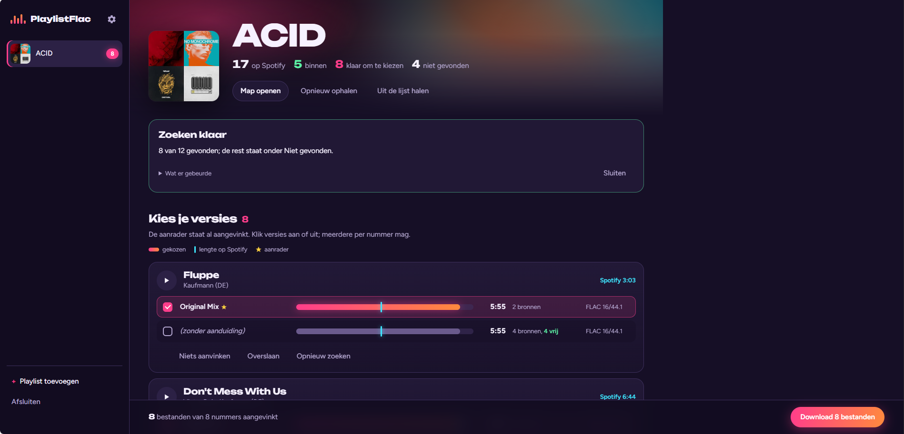

# PlaylistFlac

**English** | [Nederlands](README.nl.md)

Version 1.5.1-beta

Your Spotify playlists as folders of FLAC files (or mp3 320), downloaded
through Soulseek.

Spotify only provides the list of tracks; the music comes from Soulseek. For
each track you see which **versions** can be found (Extended Mix, Original Mix,
Radio Edit, remixes) and you pick the ones you want. Handy, because Spotify
often only has the short radio version. When tracks are added to the playlist,
they're waiting for you next time.



The interface is in English and Dutch. By default it follows your browser's
language; you can change it with the flag at the top left, next to the gear
icon.

## New in 1.5.1-beta

- **Language picker with a flag**: next to the gear icon, a flag shows the
  current language. Click it to switch between Nederlands and English.

## New in 1.5.0-beta

- **English and Dutch**: the whole interface, the messages and the tips are now
  also in English. By default PlaylistFlac follows your browser's language; you
  can choose under the gear icon (*Language*) or at the top right of the
  introduction. The analysis then also gives the cues in Traktor and rekordbox
  English names (*Load*, *Mix out -32*). This README is now in both languages.

## New in 1.4.2-beta

- **Linux**: start PlaylistFlac with `app/Start.sh`. The first time, it adds
  PlaylistFlac to your app menu and links `playlistflac://`, so `index.html`
  starts the engine by itself after that. See [On Linux](#on-linux).

## New in 1.4.1-beta

- **Clearer Traktor instructions**: the steps are now in the right order.
  First drag the files themselves into Traktor, then quit Traktor so it saves
  the collection, and only then import the `.nml`. Otherwise Traktor loses the
  covers. See [In Traktor](#in-traktor). The message after an analysis also
  reminds you of that order.

## New in 1.4.0-beta

- **Tips at the right moment**: the first time you see a part of the app
  (searching, choosing versions, the length bar, downloading, not found,
  analysing), PlaylistFlac highlights it with a short explanation. Each part
  once. To see them all again: gear icon, *Show tips again*. You can turn them
  off on the tip itself.
- **Demo**: open `index.html?demo` in your browser to try the interface with
  made-up playlists, without Soulseek. Nothing is downloaded.
- Tidied up under the hood: the program is split into parts in `app\lib`, the
  interface lives in `ui\`. Nothing else changes for you.
- The notes in the *Analysis* section show a normal bullet again instead of
  an unreadable character.

## New in 1.3.x-beta

- **1.3.5**: the `.nml` on your desktop only holds the tracks analysed this
  time, as the playlist `<playlist> (nieuw)`, so importing no longer overwrites
  cues and grids you adjusted in Traktor. Tick *Whole playlist to Traktor* if
  you want everything. *Analyse & export* is now a fold-out block on the
  playlist screen.
- **1.3.4**: an **update button** at the bottom left; PlaylistFlac checks
  GitHub and updates itself, keeping your settings, password and music.
  Already analysed tracks are skipped, and the `.nml` is put on your desktop
  as `<playlist> (PlaylistFlac).nml`, where Traktor opens its import window.
- **1.3.2 and 1.3.3**: covers stay in Traktor, because the `.nml` now carries
  the cover reference, album, genre and so on. PlaylistFlac updates the `.nml`
  by itself once Traktor has saved its collection. **Important:** turn off
  writing tags to files in Traktor's preferences. See [In Traktor](#in-traktor).
- **1.3.1**: fixes for Soulseek file names with `"`, `|`, `+` or `%`, and for
  the same track appearing twice on a playlist.
- **1.3.0**: **runs on a Mac too** (beta: not tested on a real Mac yet). See
  [On a Mac](#on-a-mac).

Earlier versions brought the Tim Selector, energy colours, an exact beatgrid
and the *Analysis* section (1.2.0), *Analyse & export* (1.1.0) and the first
shareable version with the browser interface, the queue and the `.m3u8` per
playlist (1.0.0). The Dutch README has the full history.

## What you need

- Windows 10 or 11. Nothing to install: the tool runs on PowerShell (part of
  Windows) and fetches [sockseek](https://github.com/fiso64/sockseek), the
  program that searches and downloads on Soulseek (~115 MB), the first time it
  starts.
- Or a **Mac** with macOS 13 or newer, with PowerShell 7 on it (free, see
  [On a Mac](#on-a-mac)), or **Linux** with PowerShell 7 (see
  [On Linux](#on-linux)).
- A **Soulseek account**. No need to sign up separately: a new name and
  password become an account the first time you log in. The tool can make one
  up for you. If you already use SoulseekQt or Nicotine+, use a **separate**
  account, otherwise they keep kicking each other out.
- **Public** Spotify playlists.
- A network that lets Soulseek through. Work and school networks often block
  it; at home or through your phone it usually works.

## Installing and starting

1. Unzip to a permanent place, for example `C:\Users\<you>\PlaylistFlac`.
2. **The very first time:** double-click `app\Start.cmd`. That links
   PlaylistFlac to Windows and opens the interface in your browser.
3. **After that:** open the **PlaylistFlac** shortcut on your desktop (the
   tool puts it there the first time) or simply `index.html`. The page starts
   PlaylistFlac itself. Your browser asks whether it may open PlaylistFlac;
   choose *Open* and tick *Always allow*.

A minimised *PlaylistFlac* window appears in your taskbar. That's the engine:
as long as it's open, the page works. Stop it with **Quit** in the page, or by
closing that window.

The first time, four steps take you through the settings: account, music
folder, preferences and your first playlist. You can change them later with
the **gear icon** at the top left.

### On a Mac

*Beta: this version has been built and tested on Windows and Linux, not yet on
a real Mac. If something goes wrong, let us know what you see (a screenshot of
the Terminal window helps most).*

1. **Install PowerShell 7** (once, free, from Microsoft). Download the `.pkg`
   for macOS via
   [this page](https://learn.microsoft.com/powershell/scripting/install/installing-powershell-on-macos)
   and install it. Homebrew works too: `brew install powershell`.
2. Unzip to a permanent place, for example your home folder
   (`/Users/<you>/PlaylistFlac`). Don't leave it in *Downloads* if you often
   clean that folder.
3. **The very first time:** double-click `app/Start.command`. macOS will
   probably say it comes from an *unidentified developer*:
   - click *Done* (or *Cancel*);
   - go to **System Settings → Privacy & Security**, scroll down and click
     **Open Anyway** next to *Start.command*;
   - double-click `Start.command` again and choose **Open**.

   A Terminal window opens: that's the engine, leave it open. Your browser
   opens PlaylistFlac. The first time it fetches sockseek (~110 MB).
4. **After that:** double-click **PlaylistFlac** on your desktop (the tool
   puts it there the first time), or open `index.html`. The engine then runs in
   the background without a Terminal window; stop it with **Quit** in the page.

Differences from Windows:

- Your music goes to `~/Music/<playlist>` by default; Traktor on a Mac keeps
  its collection in `~/Documents/Native Instruments`.
- For *Analyse & export*, install Python 3.13 from
  [python.org](https://www.python.org/downloads/macos/) (the macOS installer).
  The Python that comes with a Mac is too old. On a Mac with Apple silicon (M1
  and later) the analysis is probably faster than on an average Windows laptop.
- Instead of `app\Start.cmd -...` for the options below, type
  `./Start.command -...` in Terminal, in the `app` folder.

### On Linux

1. **Install PowerShell 7** (once). On Debian, Ubuntu and Kali:
   `sudo apt install powershell`; otherwise see
   [this page](https://learn.microsoft.com/powershell/scripting/install/installing-powershell-on-linux).
2. Unzip to a permanent place, for example `~/PlaylistFlac`.
3. **The very first time:** in a terminal, in the `app` folder, run
   `./Start.sh`. That adds **PlaylistFlac** to your app menu, links
   `playlistflac://` to it and opens the interface in your browser. The
   terminal window is the engine: leave it open.
4. **After that:** start **PlaylistFlac** from your app menu, or open
   `index.html`. The engine then runs in the background; stop it with **Quit**
   in the page.

Differences from Windows:

- Your music goes to `~/Music/<playlist>` by default.
- For *Analyse & export* you need Python 3.10 or newer with venv:
  `sudo apt install python3 python3-venv`.
- Instead of `app\Start.cmd -...` for the options below, type `./Start.sh -...`
  in the `app` folder.

## Using it

- **Add playlist** (bottom left): paste the Spotify link. In Spotify: the
  three dots next to the playlist, *Share*, *Copy link to playlist*.
- **Search new tracks on Soulseek**: searches everything that isn't in yet.
  You can follow its progress live.
- **Choose your versions**: a list of versions per track. Each version has a
  bar showing its length; the **cyan line** is the length on Spotify, so you
  can see at a glance which one is the long version. The recommended version
  (star) is already ticked; you can tick several, each becomes its own file.
  The play button plays a 30-second preview from Spotify.
- **Download**: the button at the bottom fetches everything that's ticked. It
  tries all files at once; if a source fails, the next round tries another
  source for the same version.
- **Queue**: searching and downloading run one after another, across
  playlists too. Choose versions in playlist A, click Download, go to playlist
  B and do the same: B joins the queue and starts by itself when A is done.
  *Next in the queue* shows what's coming; *Remove from queue* takes something
  off, *Stop everything* stops the current task and clears the queue.
- **What's happening**: during and after each task there's a log with times:
  logging in, which track it's searching, who it downloads from, what comes in
  and what fails (and why).
- **Skip**: no longer asked about. You can bring it back under *Skipped*.
- **Choose again** (under *Downloaded*): want a different version after all?
  This puts the track back in the list.

### Which version is recommended?

1. If the track on Spotify is a remix (*Domino - Space 92 Remix*), it stays
   that remix, preferably its extended version.
2. Within that, whatever comes first in *Preferred versions* wins. Default:
   `extended, original, club`.
3. If the track isn't a remix, other people's remixes go to the bottom.
4. On a tie, the version with the most free sources wins.

Recognising versions relies on the file names on Soulseek, which aren't always
tidy. When in doubt, look at the length bar.

### Why do some downloads fail?

Soulseek is ordinary people sharing their music. A source can be offline, or
put you in a queue. New accounts that share nothing themselves end up at the
back with some people. That's why PlaylistFlac picks sources with a free
upload slot first ("free" next to a version). Through a mobile hotspot, others
can't connect to you, which also costs sources. Whatever fails stays in the
list; trying again later often turns something up.

### Tim Selector: mp3 instead of FLAC

By default PlaylistFlac fetches FLAC: lossless, but around 30 to 60 MB per
track. Turn on the **Tim Selector** under the gear icon and it downloads mp3s,
with these rules:

- **Always 320 kbps.** An mp3 with a lower bitrate, or an unknown one, is
  skipped. Better no track for now than a bad mp3; it searches again next time.
- **Only mp3.** FLAC sources don't count, and *FLAC only* doesn't apply while
  the Tim Selector is on.
- **What you have stays.** A track that's already in the folder as FLAC isn't
  fetched again as mp3.

A 320 kbps mp3 is about 12 MB for a five-minute track. Handy when disk space
is short, or when your player or USB stick doesn't play FLAC. You can switch it
on or off at any time; it applies to the next downloads.

## Is it already in the folder?

For each playlist, PlaylistFlac also looks in the folder itself. A file with
the artist and the title of a track in its name counts as downloaded ("already
in the folder"). So does a `_index.csv` that sockseek left there earlier. A
different version of the same track counts too. If the Spotify track is
someone's remix (*Opal - Four Tet Remix*), that name has to be in the file as
well. Want a different version after all: *Choose again* on that track.

## Into your DJ software

In each playlist folder PlaylistFlac puts a **`<playlist>.m3u8`**, in the same
order as on Spotify. rekordbox, Serato, Engine DJ, VirtualDJ, djay, Mixxx and
Traktor all read that playlist format: drag the file (or the folder) in, and
your software analyses BPM, key and beatgrid itself. The file is updated after
every download and whenever you open the playlist.

## Analyse and export

*Beta.* The beatgrid is usually very accurate, but check the tracks before you
play them out. The cues are a starting point for you to fine-tune.

**Analyse & export** (a fold-out block on a playlist's screen) gets that
playlist ready for your DJ software, with:

- **BPM and beatgrid.** BPM to 0.001, the grid on the attack of the beat. The
  grid marker sits on the first beat of a 32-beat phrase.
- **Cues**, up to 8 hot cues:
  - the load point, on the first bar where the music starts;
  - two breaks, where the bass drops out;
  - two drops, where the bass comes back;
  - mix-out points 64 and 32 beats before the end.

  Only the last mix-out cue is a *fade-out*; in automode Traktor stops at the
  first fade-out it meets.
- **Key**: from the tags if the file already has one (from the store or Mixed
  In Key). Estimating it is possible too, but not reliable yet and therefore off
  by default; Traktor or rekordbox then works out the key.
- **Energy colour** (option): energy 1-10 in the spirit of Mixed In Key, as the
  track's colour: 1-3 blue, 4-5 violet, 6-7 green, 8-9 orange, 10 red. If the
  tags already have an energy (`ENERGYLEVEL`), that one is used. Costs about
  half a minute extra per track.

You tick what you want and for which software: Traktor, rekordbox or both.
The result goes into `data\export`:

- `<playlist>.nml`, for Traktor, with the whole playlist;
- `<playlist> (nieuw).nml`, with only the tracks analysed this time. **This
  one** is put on your desktop as `<playlist> (PlaylistFlac).nml`, with the
  playlist `<playlist> (nieuw)` in Traktor. That way grids and cues you
  adjusted in Traktor stay put. If you do want the whole playlist in Traktor,
  tick *Whole playlist to Traktor*; then the full `.nml` is on your desktop.
  If there was nothing new, the old copy is removed from your desktop so you
  don't import last time's again by accident;
- `<playlist> (rekordbox).xml`, for rekordbox, with the cues as hot cues and
  memory cues.

Tracks that are already analysed are skipped, unless you tick *Redo tracks
that are already analysed*. If a file has changed, or you want something
analysed that wasn't on last time, that track is simply done again. Failed
tracks are retried every time.

**Your music files are only read, never changed.** Expect about a minute per
track. It runs through the queue, so you can carry on in the meantime.

With the interface in English, the cues in Traktor and rekordbox get English
names (*Load*, *Break*, *Drop*, *Mix out -64*, *Mix out -32*); in Dutch they
are *Laad*, *Break*, *Drop*, *Uitmix -64*, *Uitmix -32*.

### One-time install: "Analysis? Install Python first!"

The analysis runs on Python with a neural network that finds the beats and the
first beat of the bar
([Beat This!](https://github.com/CPJKU/beat_this) from Johannes Kepler
University Linz). The first time:

1. Install **Python 3.13** from [python.org](https://www.python.org/downloads/).
   On Windows: tick *Add python.exe to PATH* on the first screen. On a Mac:
   choose the macOS installer.
2. In PlaylistFlac, click *Analyse & export* → *Install analysis*.

That downloads just over 1 GB (mostly PyTorch) into `data\analyse` and takes a
few minutes. After that the analysis works offline too. You can always remove
it: delete `data\analyse`.

### In Traktor

Importing a `.nml` overwrites a track's data in Traktor. A `.nml` can't hold
an image, only a reference to a cover Traktor already has. So the order
matters: first the files themselves into Traktor, only then the playlist.

0. **Once:** turn off writing tags to files in Traktor's preferences.
   Otherwise Traktor rewrites your music files when importing, and album and
   genre can disappear, for example.
1. **Load the files:** drag the playlist's folder into Traktor, onto the
   *Track Collection*. Traktor then reads the tracks and their covers from the
   files.
2. **Quit Traktor:** that saves the collection. Only then are the covers in
   the file PlaylistFlac can read.
3. **Wait a moment:** keep PlaylistFlac open, or start it. Within half a
   minute it updates the `.nml` on your desktop by itself.
4. **Import the playlist:** start Traktor, right-click *Playlists* →
   *Import Playlist* and pick `<playlist> (PlaylistFlac).nml` on your desktop.
5. If Traktor asks *File tags may differ from playlist tags*, choose
   **Playlist**. With File it only reads the file, and the cues and grid
   don't come through.

When tracks are added later, do the same: first the new files into Traktor,
quit, then import.

Title, artist, album and genre come from the collection, or otherwise from the
file's tags. If a track is already in your collection, importing can replace
your own grid and cues. So use this mainly for new tracks.

### In rekordbox

See the steps below; just choose the `.xml` file from `data\export`.

### How good is it?

Measured against 20 tracks whose grid was set exactly by hand in Traktor:

- **BPM** matches on all 20, to 0.001.
- **Beatgrid** is within 2 ms on 18 of the 20, mp3s included. The exception:
  a track with a click just before the kick, where the grid sits on that click
  (14 ms early). You'll hear that straight away when checking.
- **First beat of the bar** is right on all 20; on a bigger collection well
  over 90%.
- **Cues** are a starting point. Exactly where a break or build-up belongs is
  a matter of feel; move them where needed.

### After the analysis: the Analysis section

An **Analysis** section appears on the playlist with, per track, the BPM, key,
energy (with a coloured dot) and the number of cues. At the top, marked
yellow, are the tracks worth checking:

- **Start of the phrase uncertain**: check that the cues are on the right bar.
- **First beat of the bar uncertain**: check where the bar starts.
- **Grid questionable**: there's a second hit right next to the kick.

Grey is for your information: a BPM that isn't a whole number, an mp3 whose
grid was shifted for its info frame, no key in the tags. The analysis's final
message also says how many tracks to check. The report is saved as
`<playlist>.analyse.json` in `data\export`.

## Traktor collection to rekordbox

If you have Traktor and want to take **Traktor's** analysis along, use
*Traktor collection → rekordbox* in the same block. That makes a file
rekordbox reads in one go, with your playlists in folders.

What comes along: Traktor's analysis (BPM, key, beatgrid, hot cues, loops,
ratings and colours), your Traktor playlists and your PlaylistFlac playlists
in Spotify order. Tracks Traktor doesn't know yet come along without analysis;
rekordbox analyses those itself. You only see this button if Traktor is on the
computer.

The result is `data\rekordbox.xml`, rekordbox's official import format.
Traktor's `collection.nml` is only read, never changed.

In rekordbox, set up once:

1. *Preferences → Advanced → Database*: under *rekordbox xml*, choose the file
   `data\rekordbox.xml`.
2. *Preferences → View → Layout*: tick *rekordbox xml*.
3. *rekordbox xml* now appears in the tree on the left. Right-click a playlist
   or folder, *Import Playlist*.

Good to know:

- rekordbox stores BPM with two decimals. At the end of a track the grid can
  therefore be a few tens of milliseconds off from Traktor at most.
- With **mp3s**, Traktor and rekordbox sometimes decode the start slightly
  differently, so the grid can shift a fraction. Check a few mp3s. FLAC and
  WAV don't have this.
- It works from the command line too: `app\Start.cmd -Rekordbox`.

## Playlists with more than 100 tracks

By default PlaylistFlac sees the **first 100 tracks** of a playlist, and tells
you so. Two ways to get the whole list:

### Connect Spotify (optional, requires Premium)

PlaylistFlac then fetches your playlists completely, also when tracks are
added later. Spotify requires your own "developer app", and the account behind
that app must have **Premium**. It only works for playlists that are **yours**
or that you collaborate on; other people's stay at 100.

1. Go to <https://developer.spotify.com/dashboard> and log in with your
   Spotify account.
2. Click **Create app**. Name and description don't matter.
3. Under **Redirect URIs**, enter exactly `http://127.0.0.1:48721/callback` and
   click *Add*.
4. Under the APIs, tick **Web API**, accept and click **Save**.
5. Open the app, go to **Settings** and copy the **Client ID** and (via
   *View client secret*) the **Client secret**.
6. In PlaylistFlac: gear icon, paste them under *Connect Spotify*, **Save**,
   then **Log in with Spotify**. Give permission in the Spotify tab
   (PlaylistFlac only asks to read your playlists).

If a friend wants to use your app, add their Spotify email under **User
Management** in the app; otherwise they make their own app. You can log out
via the gear icon. The connection is stored in `data\spotify-token.json`.

### CSV export (without Premium)

Export the playlist as CSV, for example with
[exportify.app](https://exportify.app), and put the path in
`data\instellingen.ini` under `[playlists]`:

```ini
Big Playlist = C:\Users\you\Downloads\big_playlist.csv
```

When tracks are added, you have to export again.

## How does it know what you already have?

`data\status` holds a `<id>.keuzes.json` per playlist: which track is in (and
in which version), and which ones you skipped. Because of that:

- tracks you **delete yourself aren't downloaded again**. Want them back? Use
  *Choose again*.
- a track you remove from the playlist is **not** deleted from your folder.
  The tool only adds.

## Sharing with someone else

Open a command window in the `app` folder and type:

```
Start.cmd -Inpakken
```

That makes `release\PlaylistFlac-<version>.zip` in the PlaylistFlac folder.
Each version gets its own zip, so older ones are kept. Your `data` folder (with
your password and status) and the 115 MB of sockseek do **not** go along.

## Problems

| what you see | what it is |
|---|---|
| index.html stays on *Starting PlaylistFlac...* | the link isn't there yet: double-click `app\Start.cmd` once (Mac: `app/Start.command`, Linux: `app/Start.sh`) |
| Mac: *Start.command can't be opened* | see [On a Mac](#on-a-mac), step 3: *Open Anyway* in Privacy & Security |
| Mac or Linux: the terminal says *PlaylistFlac needs PowerShell 7* | install PowerShell 7 (step 1 under [On a Mac](#on-a-mac) or [On Linux](#on-linux)) and start again |
| *Can't reach the Soulseek server* | no internet, or the network blocks Soulseek (work, school, sometimes a VPN) |
| *Can't log in to Soulseek* | wrong password, or the name already belongs to someone else: choose another one under the gear icon |
| *Can't read the Spotify playlist* | the playlist is private, or the link isn't right |
| Spotify says *INVALID_CLIENT: Invalid redirect URI* | the Redirect URI in your Spotify app isn't exactly `http://127.0.0.1:48721/callback` |
| *Port 48721 is in use* when logging in | another program (such as sockseek) is also waiting for Spotify; close it and try again |
| *No connection to PlaylistFlac* | the *PlaylistFlac* window was closed; open index.html again |
| the wrong version was downloaded | delete the file and choose *Choose again* on that track under *Downloaded* |
| *Python not found* when installing the analysis | install Python 3.13 from python.org (Windows: with *Add python.exe to PATH* ticked), and open index.html again |
| *Install analysis* fails halfway | usually the internet connection; click again, it carries on where it was |

All details of the last task are in `data\status\laatste-run.log`.

## For advanced users

- `app\Start.cmd -Console` works without a browser, asking questions in the
  window (in Dutch). `-Console -Proef` searches and shows the versions without
  downloading.
- `app\Start.cmd -Afmelden` removes the `playlistflac://` link from Windows
  again (only for your user; no admin rights were needed). On a Mac,
  `./Start.command -Afmelden` removes the `PlaylistFlac.app` helper; on Linux,
  `./Start.sh -Afmelden` removes `playlistflac.desktop` from your app menu.
- All settings are also in `data\instellingen.ini` as text, with explanations
  (in Dutch). There you'll also find `versie-kiezen = uit` for the old
  behaviour: no choice, sockseek takes the version with the same length as on
  Spotify; and `taal = auto`, `nl` or `en` for the language.
- `app\Start.cmd -Stil` starts the interface without the `playlistflac://`
  link, shortcut or browser. Handy for testing a copy.
- When you add text to the interface, add it to `ui\lang-en.js` as well. The
  test (`tests\Test-PlaylistFlac.ps1`) and the demo in English
  (`index.html?demo&lang=en`) show what's still missing.

## Folders

| folder / file | |
|---|---|
| `index.html` | the interface; opening it starts the tool. Add `?demo` to try it with made-up playlists |
| `ui\` | the interface's styles and scripts, including the tips (`rondleiding.js`), the demo (`demo.js`) and the English texts (`lang-en.js`) |
| `docs\` | the screenshot for this README (English: `README.md`, Dutch: `README.nl.md`) |
| `release\` | the zips for sharing, one per version (only on your computer, not in the zip) |
| `tests\` | checks for whoever works on PlaylistFlac: `powershell -File tests\Test-PlaylistFlac.ps1` (not in the zip) |
| `app\` | the program: `PlaylistFlac.ps1` with its parts in `app\lib`, `Start.cmd` (Windows), `Start.command` (Mac), `Start.sh` (Linux), the analysis in `app\analyse`, and sockseek in `app\bin` |
| `PlaylistFlac.app` | Mac only: the helper that starts the tool and handles `playlistflac://`; the tool makes it itself |
| `data\` | your settings and status. Don't share it, your password is in there. Get a new version with the update button at the bottom left; it leaves `data\` alone. |
| `data\export` | the analysed playlists for Traktor and rekordbox |
| `data\analyse` | Python with PyTorch for the analysis (just over 1 GB, only if you install it) |

Use it for music you have the rights to.

## Copyright

Copyright (c) 2026 WiWi Audio.

Third-party work used:

- [sockseek](https://github.com/fiso64/sockseek) by fiso64 (GPL-3.0) does the
  searching and downloading on Soulseek. It isn't in this zip; PlaylistFlac
  fetches it from GitHub the first time it starts.
- The Unbounded and Figtree typefaces (SIL Open Font License) come from Google
  Fonts.
- The gear icon comes from Google's Material Icons (Apache License 2.0).
- The analysis uses [Beat This!](https://github.com/CPJKU/beat_this) from the
  Institute of Computational Perception, JKU Linz (MIT License), plus
  [PyTorch](https://pytorch.org) (BSD) and [librosa](https://librosa.org)
  (ISC). They aren't in this zip; they're installed when you turn on the
  analysis.
